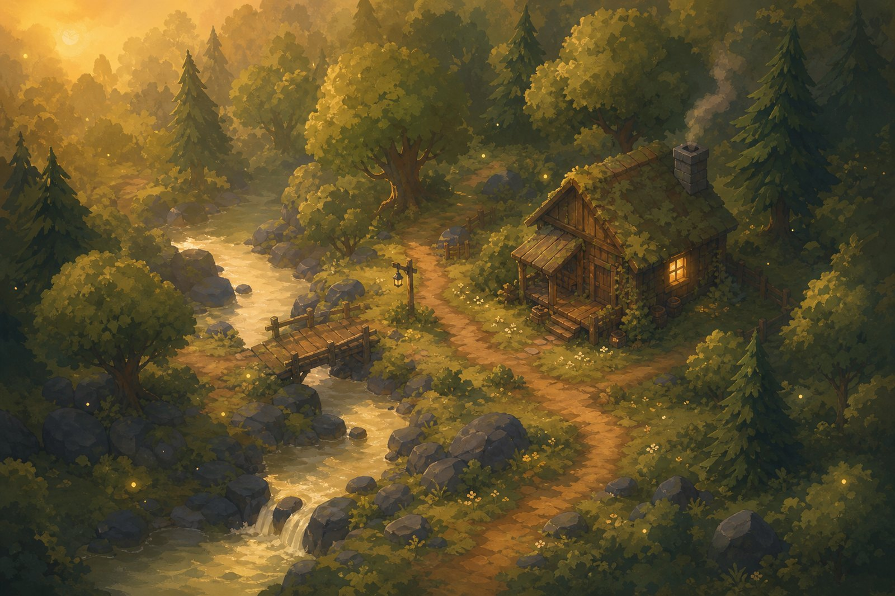

# Mosswood

A cozy 2.5D forest you can wander, gather from and build a little home in.
Plain HTML + ES modules + a vendored copy of three.js — no build step, no
server, no external requests. Drop it on GitHub Pages and it runs.

**Play:** open `index.html` (or the Pages URL).



---

## The look

The whole game is shaded by a handful of small hand-written GLSL programs that
turn geometry into flat, painted bands rather than smooth PBR:

* **four light bands** (`smoothstep` thresholds) instead of a lambert ramp
* **no textures at all** — there is not a single photographic leaf in here.
  Grass is thousands of painted blades, a bush is a dark core wrapped in leaf
  lobes, a crown is a stack of lobes, a pine is a tower of jagged needle skirts
* **baked horizon AO + soft contact shadows** under everything that stands up
* **palette sampled directly from the reference paintings** (see
  `src/terrain/terrain.js` → `PALETTE`), with a slow painted mottle and
  brush-stroke texture in the terrain shader
* unifying `grade()` pass: gentle desaturation + warm bias
* warm haze that swallows the distance

Everything animates: every grass blade, frond, bush and tree sways on its own
wind phase in the vertex shader — a slow gust plus a faster flutter, so the
whole valley breathes instead of moving in lockstep.

## The valley

`src/terrain/terrain.js` builds the world in layers so it looks hand-made
rather than noise-made:

1. **river spine** — a meandering centreline that steps down in tiers
2. **valley shaping** — the land is built *relative to the local water level*,
   so the hills step down with the river
3. **domain-warped fBm + ridged noise** — organic masses, no visible grid
4. **hydraulic erosion** (droplet simulation) — gravity gullies, sediment fans
5. **stratified terracing** — blurred height is quantised and the residual
   detail added back, producing wide hand-flattened treads and crisp ledges
6. **weathering erosion** — a second, lighter pass cuts gullies through ledges
7. **river carving** — scoured banks, a plunge pool under every fall
8. **a worn footpath** and a **hand-flattened home clearing**
9. **horizon AO + baked sun shadows + painted colour bands**

The same seed always grows the same valley, so a save file is a seed plus a
list of what you built.

## Building

Grid-snapped, terrain-hugging, rotate-and-place with a green/red ghost.
Fences and dry-stone walls detect their neighbours and re-draw themselves, so
a wall built stone by stone still reads as one continuous thing.

| Item | Cost |
| --- | --- |
| Dirt path | free |
| Fence | 2 wood |
| Stone wall | 3 stone |
| Bench | 4 wood |
| Lantern | 2 wood · 2 fiber |
| Campfire | 3 wood · 4 stone |
| Garden bed | 4 wood · 2 fiber |
| Flower box | 3 wood · 2 fiber |
| Signpost | 2 wood |
| Well | 6 stone · 4 wood |
| Bridge | 8 wood |
| Cabin | 18 wood · 6 fiber · 4 stone |
| Sapling | 3 fiber |

Lanterns, campfires and cabin windows light up on their own as the day slides
into dusk. Campfires breathe, chimneys smoke, saplings grow.

## Controls

**iPad / touch** — thumb-stick bottom-left; tap the ground to walk there; tap a
tree, boulder, bush or log to gather; Build → pick → tap to place; ↻ rotates;
✕ removes and refunds part of the cost.

**Desktop** — WASD / arrows to walk, `E` or `Space` to gather the nearest
plant, `B` build tray, `1..9` quick pick, `R` rotate, `X` remove, `Esc` cancel.

The camera is fixed by design: one angle, one zoom, no orbiting. The game is
composed to be read exactly one way.

## Tech notes

* Fixed 26° perspective camera at 52° elevation — reads as 2.5D, is real 3D.
* Instanced everything: ~30k foliage cards in 6 draw calls, plus instanced
  rocks, trunks, canopy masses and shadows.
* No shadow maps — painterly contact-shadow decals + baked terrain lighting.
* Adaptive quality: measures frame time and drops DPR / effects on slower
  devices (iPads included).
* Audio is synthesised at runtime with WebAudio — wind, stream, birds,
  crickets, and every interaction sound. No audio files.
* Saves to `localStorage`. Nothing leaves your device.

## Files

```
index.html            the shell
styles/game.css       parchment UI
src/terrain/          noise, generation, palette
src/render/           terrain mesh, plants, props, water, effects, materials
src/game/             player, building, audio, save, game loop
src/ui/               HUD, build tray, thumb-stick
src/vendor/           three.js (MIT) + BufferGeometryUtils
assets/art/           key art + icon
```

## Running locally

Because it uses ES modules you need any static file server:

```bash
python3 -m http.server 8080
# then open http://localhost:8080
```

## Credits

Built with [three.js](https://threejs.org) (MIT). Sprites and key art were
generated with an image model, then chroma-keyed, trimmed and palette-matched.
Everything else — terrain, shaders, geometry, audio, UI — is procedural code in
this repository.
